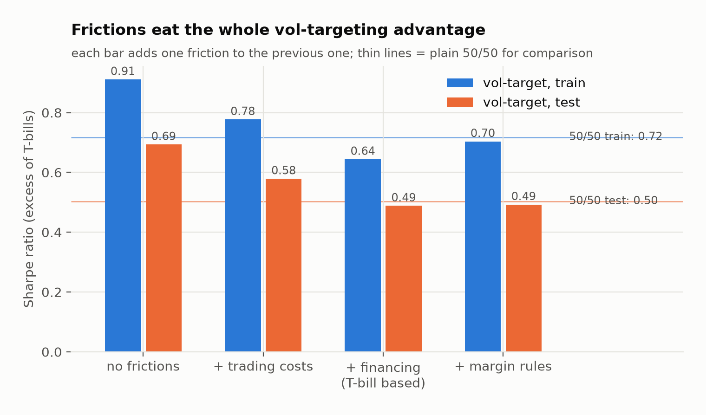

# Vol targeting + MA regime cap, with realistic costs and margin

Does a levered volatility-target overlay on a 50/50 SPY/TLT portfolio still pay off once you
model trading costs, T-bill-based financing, margin calls and execution lag, and pick
parameters only on past data?

**Result (out of sample, 2016–2026):**
- **No reliable return edge:** Sharpe 0.52 vs 0.50 for plain 50/50, t = 0.35.
- **Shallower drawdowns:** −23% vs −29%.
- **The trend filter adds nothing;** whether the overlay is worth running depends on your
  borrowing rate.

**→ Full write-up: [REPORT.md](REPORT.md)**



## Quick start

```bash
uv run voltarget all      # download prices (first run), run all experiments, draw charts
uv run pytest             # 6 tests: no look-ahead, execution lag, accounting, band, margin, gate
```

## Layout

| Path | Purpose |
|---|---|
| `src/voltarget/config.py` | All parameters, the train/test split and the frictions |
| `signals.py` | Vol-target leverage, simple and hysteresis MA gates, regime cap (no look-ahead) |
| `simulate.py` | Daily account: cash + holdings, trading costs, financing, initial and maintenance margin, one-day lag |
| `metrics.py` | CAGR, volatility, Sharpe in excess of T-bills, max drawdown, turnover, cost breakdown |
| `experiments.py` | 96-setting sweep, pre-registered selection, benchmarks, realism ladder, cost sensitivity, ablation |
| `figures.py` | Charts in `reports/figures/` |
| `reports/tables/` | All result tables (CSV) and `summary.json` |

## Use it on other assets

Edit `TICKERS` in `config.py`. The first ticker drives the MA regime gate. Adjust `Frictions`
(trading bp, borrow spread, margin) to match your broker.

## License

[MIT](LICENSE). Price data comes from Yahoo Finance via `yfinance` and is not included.
