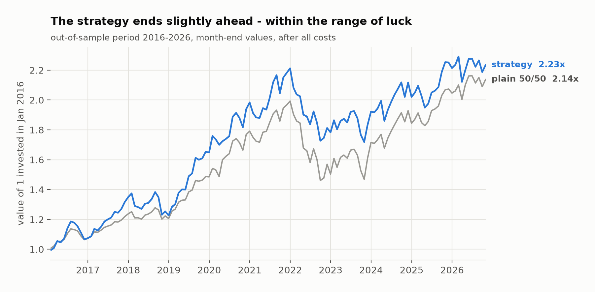
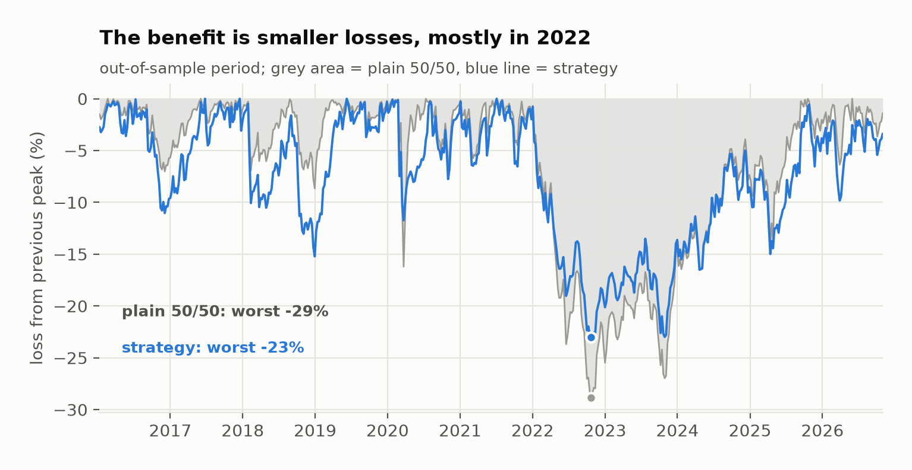
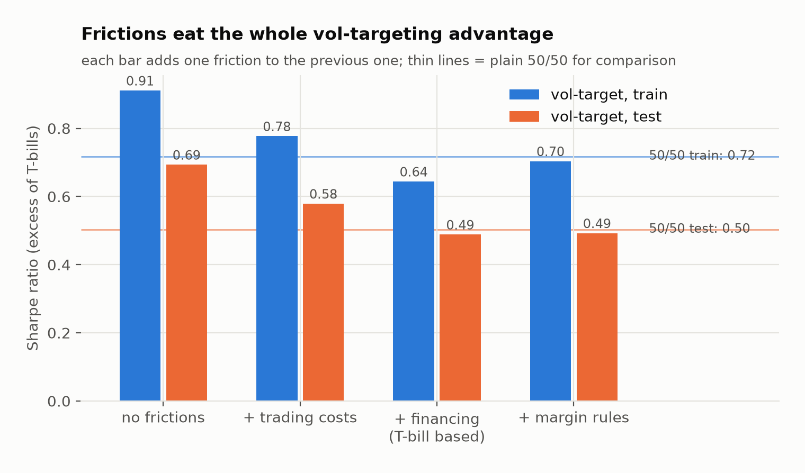
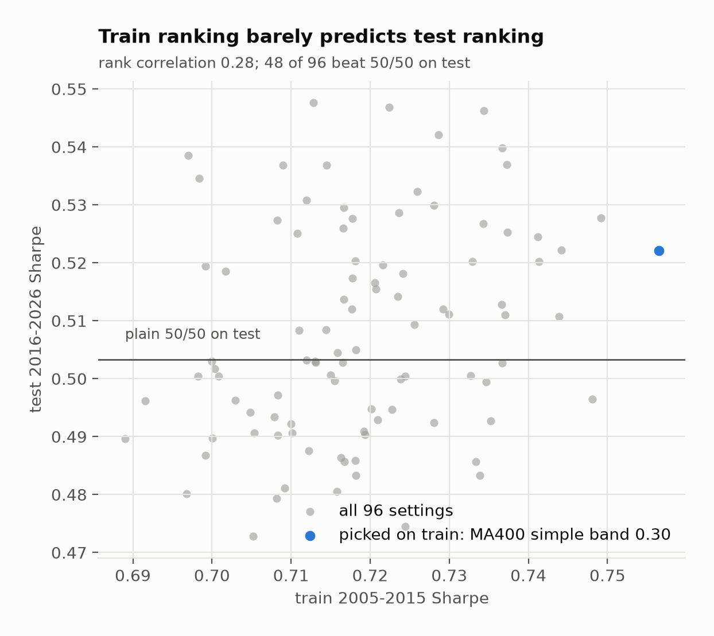
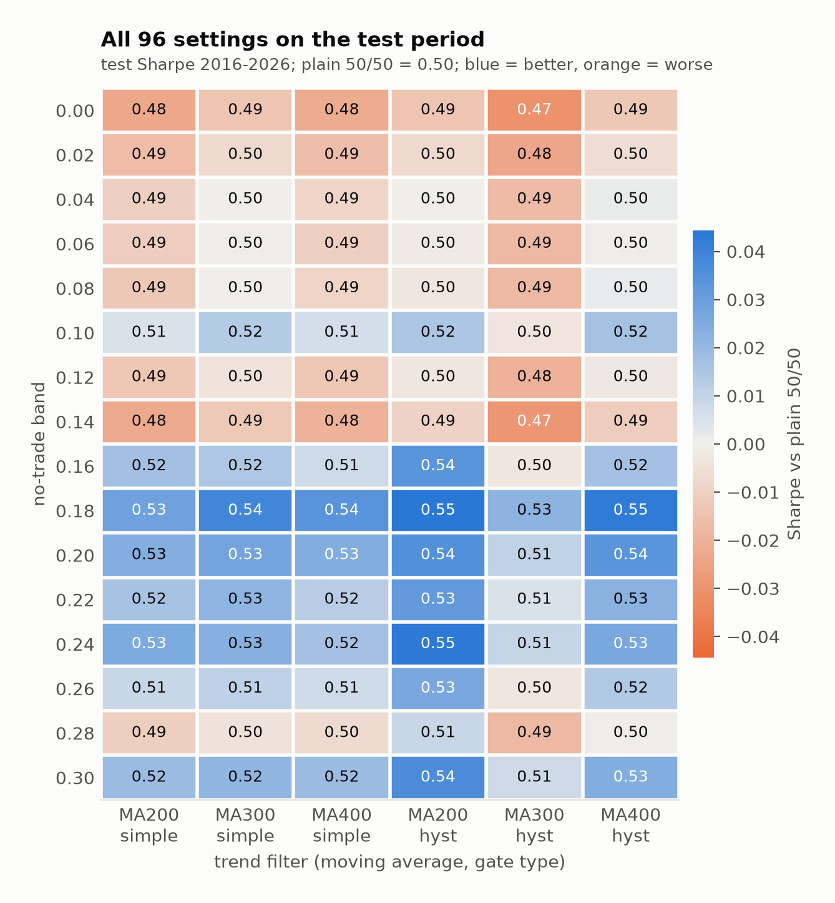
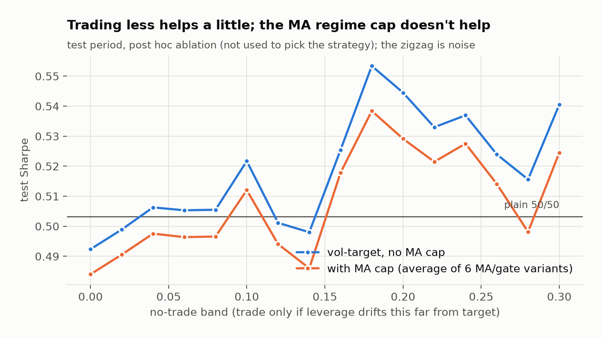
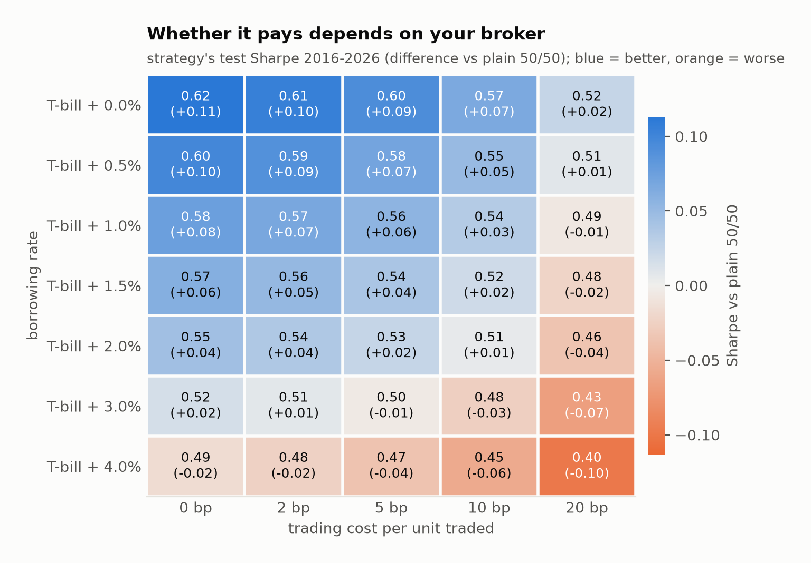

# Levered volatility targeting with a trend filter: does it survive real costs, out of sample?

**Research report · v2 · November 2026 · data Aug 2005 – Oct 2026 (SPY, TLT, 3-month T-bill)**

## Summary

The strategy is a classic overlay on a 50/50 SPY/TLT portfolio:
- **Vol targeting:** scale exposure up or down to aim for 10% annual volatility, using up to 2x
  leverage.
- **Trend filter ("regime cap"):** forbid borrowing whenever SPY is below its long moving average.

I tested it with realistic frictions:
- trading costs on actual traded notional;
- borrowing at the real T-bill rate plus a broker spread, while idle cash earns interest;
- Reg-T style margin with forced deleveraging;
- a full day of execution lag.

The 96 parameter settings were chosen on **2005–2015** and judged only on **2016–2026**.

**Findings:**
- **No reliable return edge.** On the test period, the pre-selected setting earns a Sharpe of
  **0.52 vs 0.50** for plain 50/50, about +0.5% a year. That's statistically indistinguishable
  from zero (t = 0.35). Half of all 96 settings beat 50/50 on test and half don't.
- **Shallower drawdowns.** The worst test-period loss falls from **−29% to −23%** at about the
  same volatility, mainly in the 2022 stock-bond crash.
- **The trend filter contributes nothing.** The drawdown benefit comes from vol targeting
  itself. Removing the MA cap doesn't hurt; trading less (a wider no-trade band) helps a little.
- **Frictions decide the result.** Without costs, vol targeting lifts the Sharpe from 0.50 to
  0.69 on test. Trading costs and financing consume all of that. With a cheap broker (T-bill
  +0.5%, 2 bp) the overlay keeps a small edge (0.59); with an expensive one (+3%, 10 bp) it
  loses (0.48).

**Bottom line:** at retail financing costs, this is a drawdown-control tool, not a return
enhancer.



---

## 1. Strategy

| Component | Rule |
|---|---|
| Base portfolio | 50% SPY, 50% TLT (total-return prices), reset to 50/50 on the first trading day of each month |
| Vol target | Target leverage = 10% ÷ realized volatility of the base portfolio over 20 days, capped at 3x |
| Regime cap | If SPY is below its 200/300/400-day MA, leverage is capped at 1x (no borrowing). *Simple* gate: price vs. MA. *Hysteresis* gate: on above MA+1%, off below MA−1% |
| No-trade band | Re-leverage only if actual leverage has drifted more than the band (0.00–0.30) from the target |

## 2. Simulation: what makes it realistic

One account with cash and holdings, simulated daily. At each close, in order:

1. **Returns:** holdings earn the day's close-to-close return.
2. **Financing:** negative cash pays **T-bill + 1.5%**; positive cash earns **T-bill − 0.5%**
   (floored at 0). The rate is the one known the day before. The T-bill rate is the 13-week
   yield (`^IRX`), which was near zero in 2009–15 and 2020–21 and around 5% in 2023–24. Version 1
   of this project used a flat 6%, which overcharged leverage in the zero-rate years.
3. **Maintenance margin:** if gross exposure exceeds 2.86x equity (30% maintenance plus a 5%
   buffer), the account is **forced to deleverage** at the close and pays trading costs on it.
4. **Scheduled trade:** toward the target computed at the *previous* close, capped at 2x
   (50% initial margin), costing **10 bp of traded notional**. So a signal from close *t*
   first earns returns on day *t+2*: one full day of lag.

Tests in `tests/test_simulator.py` check:
- no look-ahead in the signals;
- the exact one-day lag;
- cost and interest accounting to the cent;
- that the band suppresses trading;
- forced deleveraging after a crash;
- the hysteresis gate.

## 3. Out-of-sample protocol

- **Train:** Aug 2005 – Dec 2015, which includes 2008. **Test:** Jan 2016 – Oct 2026, which
  includes 2020 and 2022. Every simulation starts in Aug 2005, after a 400-day signal warm-up.
- **Selection rule, fixed before the first run:** the highest *train* Sharpe among the 96
  settings (3 MAs × 2 gates × 16 bands) with no forced liquidation in train. The result was
  **MA400, simple gate, band 0.30**.
- **Benchmarks:**
  - **Base 50/50**, unlevered;
  - **Static leverage:** a constant 1.04x, set on train to hit 10% vol, with no timing;
  - **Vol-target only:** no trend filter, band 0.
- **Sharpe** is measured on returns *in excess of the T-bill rate*.

## 4. Results

### 4.1 Head to head, test period 2016–2026

| | CAGR | Vol | Sharpe | Max DD | Avg lev | Turnover / yr | Trading cost / yr | Net interest / yr |
|---|---|---|---|---|---|---|---|---|
| Base 50/50 | 7.3% | 10.5% | 0.50 | −28.8% | 1.00 | 0.3x | 0.03% | 0.00% |
| Static leverage 1.04x | 7.4% | 10.9% | 0.50 | −29.9% | 1.04 | 0.3x | 0.03% | −0.16% |
| Vol-target only | 7.3% | 11.0% | 0.49 | −23.8% | 1.27 | 10.0x | 1.00% | −0.90% |
| **Selected (MA400, simple, band 0.30)** | **7.7%** | 11.0% | **0.52** | **−23.0%** | 1.27 | 4.8x | 0.48% | −0.90% |

The selected setting minus Base comes to **+0.46% a year, t = 0.35**: not significant.

In train (2005–15), the same setting had a Sharpe of 0.76 against 0.72 for Base. That's
expected, because it was picked as the best of 96 on that period.



### 4.2 Where the vol-targeting advantage goes



The chart adds one friction at a time to vol-target only:
- **Without frictions,** vol targeting clearly beats 50/50: test Sharpe 0.69 vs 0.50.
- **Trading costs:** about 10x turnover a year at 10 bp takes roughly 1% a year.
- **Financing:** borrowing about 0.3x of equity at T-bill + 1.5% takes roughly another 1%.
- **Margin rules:** the 2x cap on new positions slightly *helps*, because it trims the most
  expensive leverage.

### 4.3 Parameter choice is mostly noise



- **Rank correlation** between train and test Sharpe across the 96 settings: **0.28**.
- **The selected setting ranks 25th of 96 on test,** better than average but far from the top.
- **48 of 96 settings beat 50/50 on test,** exactly a coin flip.



The colours follow the rows (the band), not the columns (the trend filter). In other words,
what matters is how often you trade, not which filter you use.

### 4.4 Which component matters (post hoc ablation)



- **The trend filter never helps.** Averaged across the 6 MA/gate variants, it's slightly
  *worse* than no filter at every band. Test Sharpe by MA: 0.51 / 0.50 / 0.51; by gate: 0.51 /
  0.51.
- **A wider band helps a little,** because it halves turnover and trading costs. The curve is
  jagged, though, and the best band on test (0.18) isn't the best on train. Treat "trade less"
  as the lesson, not a specific number.

### 4.5 Sensitivity to broker costs (test Sharpe)



The strategy beats 50/50 (blue) only when costs stay low:
- **at 10 bp trading cost,** only while borrowing is at most T-bill + 2%;
- **at 20 bp,** practically never;
- **even at the cheapest settings,** the gain is at most +0.11 Sharpe.

The table covers the middle of the grid; the baseline is in bold:

| Borrow spread over T-bill | Trading cost | Base 50/50 | Selected | Static 1.04x |
|---|---|---|---|---|
| 0.5% | 2 bp | 0.51 | **0.59** | 0.50 |
| 0.5% | 10 bp | 0.50 | 0.55 | 0.50 |
| 1.5% | 2 bp | 0.51 | 0.56 | 0.50 |
| **1.5%** | **10 bp** (baseline) | 0.50 | 0.52 | 0.50 |
| 3.0% | 2 bp | 0.51 | 0.51 | 0.49 |
| 3.0% | 10 bp | 0.50 | 0.48 | 0.49 |

Whether the overlay is worth running depends mostly on **your financing rate**. At an
institutional-like 0.5% spread it adds about 0.05–0.09 Sharpe; at a typical retail 3% it's
gone.

## 5. Interpretation

Vol targeting works through a well-documented effect: volatility clusters, and returns in
high-volatility periods are poor relative to the risk taken. Cutting exposure when volatility
rises raises the gross Sharpe, as the frictionless 0.69 shows. But a levered implementation
pays for that twice:
- **in turnover:** leverage has to be adjusted constantly;
- **in financing:** leverage is borrowed.

For a 50/50 stock-bond portfolio, which already has low volatility, the gross gain is about the
same size as those costs.

The trend filter was meant to avoid borrowing in bear markets, but vol targeting already cuts
leverage then: volatility rises when markets fall. So the filter is mostly redundant.

## 6. Limitations

- **Two assets, one period.** The test window (2016–2026) contains only a few stress episodes
  (2018 Q4, 2020, 2022). A single crash can swing these comparisons.
- **Close-to-close execution.** The model trades at the close with a fixed bp cost. It has no
  slippage model for stressed markets, when forced deleveraging actually happens.
- **Financing.** One spread over T-bills for the whole period. Real broker spreads vary with
  account size and over time.
- **ETF total-return data** comes from Yahoo Finance (adjusted closes). There are no taxes and no
  dividend-timing effects.
- **The selection rule (max train Sharpe) is one choice among many.** The train-vs-test chart
  shows that any rule picking from this grid would have been close to a coin flip.

## 7. What changed from v1

v1 is preserved in the git history. Its "best" setting looked worse than 50/50 (Sharpe 0.71
vs 0.82). The main fixes, roughly in order of impact:

| v1 | v2 |
|---|---|
| "Best" chosen and reported on the same 2004–2026 data | Chosen on 2005–15, reported on 2016–26; rule fixed in advance |
| Signal and execution at the same close, labelled a "one-day lag" | A real one-day lag (signal at close t, trade at close t+1) |
| Borrowing at a flat 6% for 22 years; idle cash earns 0; Sharpe vs 0% | T-bill + spread; cash earns T-bill − 0.5%; Sharpe in excess of T-bills |
| "No-trade band" didn't stop daily re-leveraging | Trades only when leverage drifts more than the band |
| Selection only among HYST settings | All 96 settings eligible |
| No benchmark for "just use leverage" | Static-leverage benchmark |
| No tests; unpinned data | 6 tests; data window pinned, cached locally |

## Reproducing

```bash
uv run voltarget all            # download (first run) -> 96-setting sweep + benchmarks -> charts
uv run voltarget all --refresh  # re-download prices from Yahoo Finance
uv run pytest
```

Tables are in `reports/tables/` and charts in `reports/figures/`. Prices are cached in `data/`,
which is not committed; Yahoo data may change slightly between downloads.
